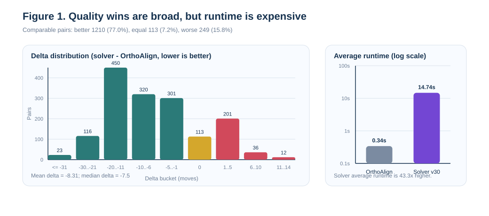
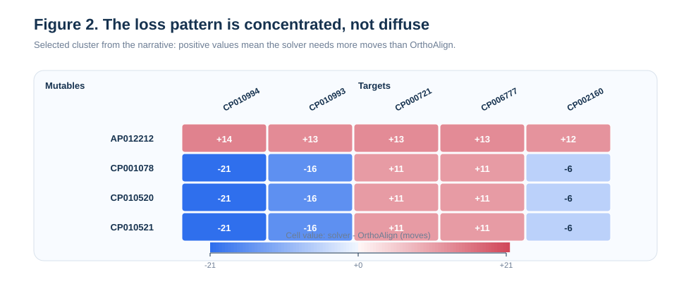
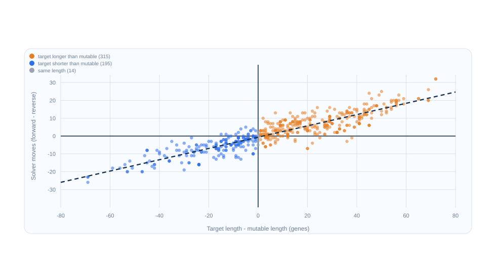

# Clostridium Pair Sweep

Solver version: `v30`

This folder contains the final all-pairs Clostridium sweep for the frozen
`v30` solver. The previous `v19` sweep was preserved before rerunning and is
available in `analysis/clostridium_pairs_full_v19_archive/`.

| Metric | Value |
|---|---:|
| Genomes | 51 |
| Genomes without exactly one [t] | 3 |
| Total directed pairs | 2550 |
| Solvable directed pairs | 1729 |
| Discarded unsolvable pairs | 821 |
| Evaluated pairs | 1729 |
| Solver solved pairs | 1576 |
| Solver parse-error pairs | 153 |
| OrthoAlign scored pairs | 1722 |
| Comparable pairs | 1572 |
| Solver better than OrthoAlign | 1210 |
| Solver equal to OrthoAlign | 113 |
| Solver worse than OrthoAlign | 249 |
| Avg OrthoAlign cost | 43.88 |
| Avg solver moves | 35.57 |
| Avg delta (solver - OrthoAlign) | -8.31 |
| Median delta | -7.50 |
| Avg ratio (solver / OrthoAlign) | 0.840 |
| Median ratio | 0.821 |
| Avg OrthoAlign runtime (ms) | 340.1 |
| Avg solver runtime (ms) | 14737.9 |

## Visual Overview

Figure 1 shows the main tradeoff clearly. Most comparable pairs still land on
the solver-favorable side of `(solver - OrthoAlign)`, but the runtime gap
remains large: about `14.74s` for the solver versus `0.34s` for OrthoAlign on
average. All figures in this document are generated from `pairs_all.tsv` by
`generate_figures.py`.

## What v30 Is

`v30` is not a brand-new heuristic. It keeps the same core frontier-growing
solver that emerged in Phase 2 and that was analyzed historically as `v19`:

- anchored growth outward from `[t]`
- frontier duplications and deletions as the default macro moves
- bounded inversions as structural reset moves
- one-step lookahead
- bounded opening inversion rollout
- bounded duplication-length rollout

What changed from `v19` to `v30` is mostly search control during strong growth
states, where the target is much longer than the current genome. In those
states, `v30` prunes expensive candidate families that rarely help:

- frontier deletions are delayed until the length gap shrinks to `3` genes
- duplication-length rollout is skipped
- frontier duplication sources are capped more aggressively
- inversions are suppressed after the opening once the anchored core is no
  longer tiny

That makes `v30` best understood as the final accelerated form of the `v19`
heuristic, not as a different solver family.

## Main Result

The headline result remains strong. On the `1572` pairs where both tools
produced a score, `v30` was at or below the OrthoAlign score on `1323` pairs
(`84.2%`). It beat OrthoAlign outright on `1210` pairs (`77.0%`), tied on
`113`, and was worse on `249`.

The average delta stayed strongly solver-favorable at `-8.31` moves, with a
median delta of `-7.5`. So the win is still broad rather than being driven by a
small number of outliers.

Relative to the archived `v19` sweep, the full-sweep quality is effectively
flat:

- `v19` avg ratio: `0.84007`
- `v30` avg ratio: `0.84038`
- `v19` average solver runtime: `16.15s`
- `v30` average solver runtime: `14.74s`

So the main benefit of the final `v30` rerun is speed, not a major quality
shift. In average solver wall-clock time, that is about an `8.8%` improvement
over the archived `v19` sweep.

## Coverage And Data Quality

The solver again solved every pair it could parse. The only solver failures
were the `153` pairs involving the `3` genomes that do not contain exactly one
`[t]`:

- `CP006902_ 1408284.5`
- `CP006907_ 1408285.4`
- `CP012395_ 1341692.11`

Those are data-format problems, not heuristic search failures. OrthoAlign also
failed on a handful of additional pairs, so not every solvable pair became a
fair head-to-head comparison.

## Win Pattern

The strongest wins are still concentrated around `CP006908_ 1408283.5`. It
appears repeatedly in the best-pair list with deltas around `-46` to `-48`,
which suggests the frontier-plus-rollout heuristic is especially effective when
the puzzle can be resolved with a small number of large structural edits around
`[t]`.

More broadly, the sweep still supports the main Phase 2 claim: the restricted
game move set is highly competitive on this Clostridium family even against an
external alignment tool with a broader event model.

## Loss Pattern

The loss pattern is still sharply concentrated rather than diffuse.
`AP012212_ 1042156.4` remains the hardest mutable genome in the sweep, with
`20` worse-than-OrthoAlign pairs and an average delta of about `+4.13`. Its
hardest targets are the long repeated genomes:

- `CP010994_ 1502.177`
- `CP010993_ 1502.176`
- `CP000721_ 290402.41`
- `CP006777_ 864803.3`

There is also a second recurring loss cluster where compact 23-gene-family
mutables such as `CP001078_ 508767.5`, `CP010520_ 1491.354`, and
`CP010521_ 1491.355` lose specifically against `CP000721_ 290402.41` and
`CP006777_ 864803.3`.

Figure 2 makes that structure visible. The `AP012212` row is uniformly positive
against the long-target set, while the `CP001078` / `CP010520` / `CP010521`
rows light up mainly against `CP000721` and `CP006777`. This is the signature
of a targeted growth-phase weakness rather than a general collapse in solution
quality.

## Runtime Tradeoff

The solver is still much slower than OrthoAlign in absolute runtime:

- OrthoAlign: about `0.34s` per pair
- `v30`: about `14.74s` per pair

That makes the current position "better scores, much slower search," not
"strictly better in every dimension." Still, the `v30` rerun confirms that the
Phase 3 pruning work did buy real time back without materially changing the full
sweep's quality profile.

## Best Pairs

| Mutable | Target | OrthoAlign | Solver | Delta | Ratio |
|---|---|---:|---:|---:|---:|
| AP014696_ 1491.356 | CP006908_ 1408283.5 | 55 | 7 | -48 | 0.127 |
| CP000939_ 498213.7 | CP006908_ 1408283.5 | 53 | 6 | -47 | 0.113 |
| CP006908_ 1408283.5 | CP000939_ 498213.7 | 56 | 9 | -47 | 0.161 |
| CP000728_ 441772.13 | CP006908_ 1408283.5 | 52 | 6 | -46 | 0.115 |
| CP000962_ 498214.7 | CP006908_ 1408283.5 | 52 | 6 | -46 | 0.115 |
| CP011663_ 1509.39 | CP006908_ 1408283.5 | 52 | 6 | -46 | 0.115 |
| CP009225_ 1509.28 | CP006908_ 1408283.5 | 53 | 7 | -46 | 0.132 |
| CP006908_ 1408283.5 | CP000728_ 441772.13 | 54 | 8 | -46 | 0.148 |
| CP006908_ 1408283.5 | CP000962_ 498214.7 | 54 | 8 | -46 | 0.148 |
| CP006908_ 1408283.5 | CP011663_ 1509.39 | 54 | 8 | -46 | 0.148 |

## Worst Pairs

| Mutable | Target | OrthoAlign | Solver | Delta | Ratio |
|---|---|---:|---:|---:|---:|
| AP012212_ 1042156.4 | CP010994_ 1502.177 | 52 | 66 | 14 | 1.269 |
| AP012212_ 1042156.4 | CP010993_ 1502.176 | 53 | 66 | 13 | 1.245 |
| AP012212_ 1042156.4 | CP000721_ 290402.41 | 60 | 73 | 13 | 1.217 |
| AP012212_ 1042156.4 | CP006777_ 864803.3 | 60 | 73 | 13 | 1.217 |
| AP012212_ 1042156.4 | CP002160_ 573061.5 | 48 | 60 | 12 | 1.250 |
| CP001078_ 508767.5 | CP000721_ 290402.41 | 25 | 36 | 11 | 1.440 |
| CP001078_ 508767.5 | CP006777_ 864803.3 | 25 | 36 | 11 | 1.440 |
| CP010520_ 1491.354 | CP000721_ 290402.41 | 25 | 36 | 11 | 1.440 |
| CP010520_ 1491.354 | CP006777_ 864803.3 | 25 | 36 | 11 | 1.440 |
| CP010521_ 1491.355 | CP000721_ 290402.41 | 25 | 36 | 11 | 1.440 |

## Directional Asymmetry

### Setup

Of the `1572` comparable pairs, `524` canonical pairs have both directions
present, solved by the solver, and scored by OrthoAlign. That gives a clean
head-to-head directional comparison.

### OrthoAlign Is Nearly Symmetric

Across those `524` matched pairs, `183` (`35%`) produce exactly the same
OrthoAlign cost in both directions. The mean absolute directional difference is
`1.25` moves and the maximum is `6`.

### The Solver Is Strongly Asymmetric

Only `36` of the `524` matched pairs (`7%`) are symmetric under the solver. The
mean absolute difference is `7.34` moves, the median is `6`, and the maximum is
`32`.

### Length Gap Explains Most Of The Asymmetry

The Pearson correlation between `(target length - mutable length)` and
`(solver moves A->B - solver moves B->A)` is `r = 0.90`.

| Direction | n | Mean solver diff (fwd - rev) | Growth harder? |
|---|---:|---:|---|
| Expanding (mutable shorter than target) | 315 | +7.26 | yes, 85.7% of pairs |
| Shrinking (mutable longer than target) | 195 | -6.79 | yes (contraction easier), 90.3% of pairs |
| Same length | 14 | -0.50 | n/a |

The magnitude also scales with the size of the length gap:

| Length gap | n | Mean \|solver diff\| |
|---|---:|---:|
| 0-20 genes | 289 | 4.10 |
| 21-50 genes | 198 | 9.73 |
| 51+ genes | 37 | 19.86 |

Figure 3 shows that relationship directly. When the target is longer than the
mutable, the points move into the upper-right: forward growth gets harder. When
the target is shorter, they move into the lower-left: contraction gets easier.

### Extreme Examples

The most asymmetric pairs in absolute terms still involve
`AP012212_ 1042156.4` (66 genes) paired with the two 138-gene genomes
`CP000721_ 290402.41` and `CP006777_ 864803.3`. The solver uses `73` moves
growing from the 66-gene mutable to the 138-gene target, but only `41` moves
going the other way. OrthoAlign reports exactly `60` in both directions.

Similarly, `CP000721_ 290402.41` (138 genes) -> `CP010086_ 1520.6` (85 genes)
costs only `19` solver moves in the contraction direction, while the reverse
costs `39`. OrthoAlign scores both at `29-30`.

At the other extreme, trivially close pairs like `CP000726_ 441770.6` ->
`CP000939_ 498213.7` differ by only `1` solver move across directions, and
OrthoAlign is perfectly symmetric there.

### Interpretation

This asymmetry is a heuristic bias, not a property of the underlying edit
distance. The solver is anchored at `[t]` and prefers to grow an exact matching
core outward from material that already exists in the current genome. That
works naturally in contraction and cleanup settings, but it makes long repeated
growth harder.

The Phase 3 pruning from `v19` to `v30` improved runtime, but it did not remove
that structural asymmetry. That is still the clearest open algorithmic weakness
if future work continues beyond the final paper.
