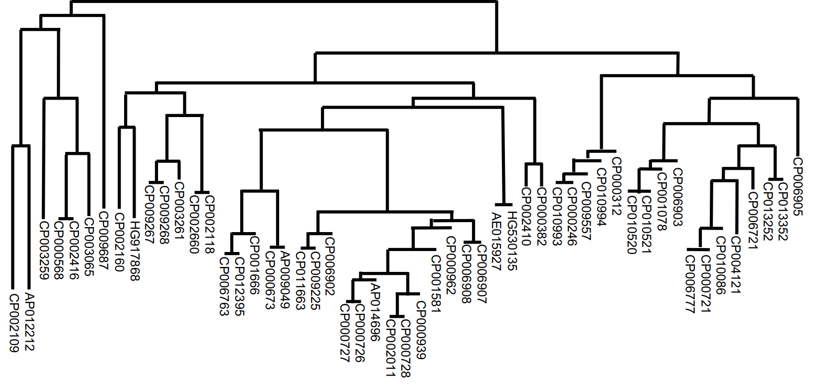
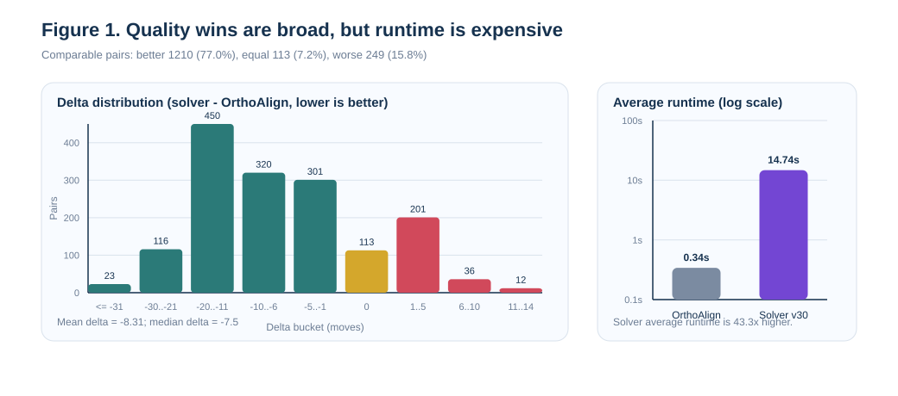
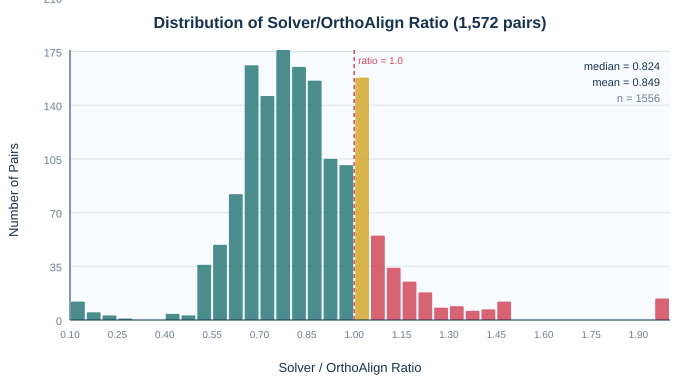
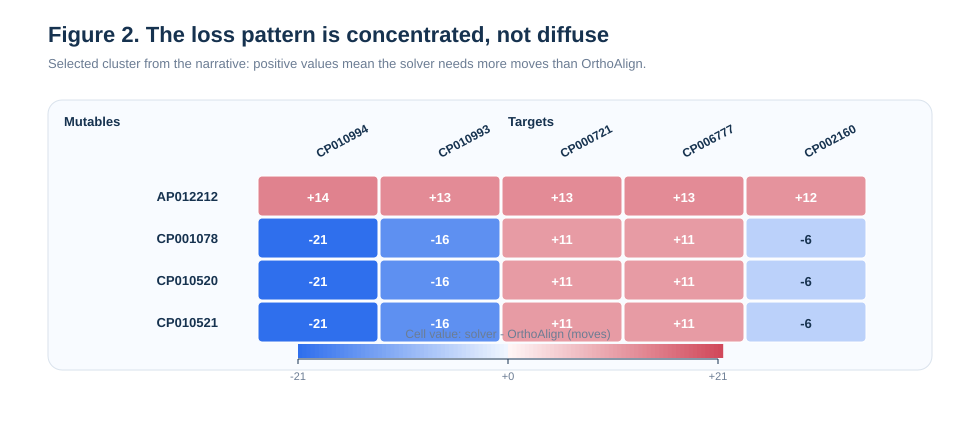
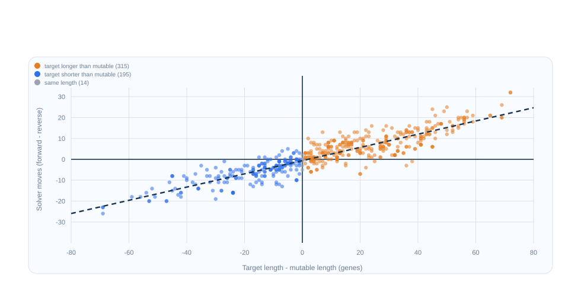
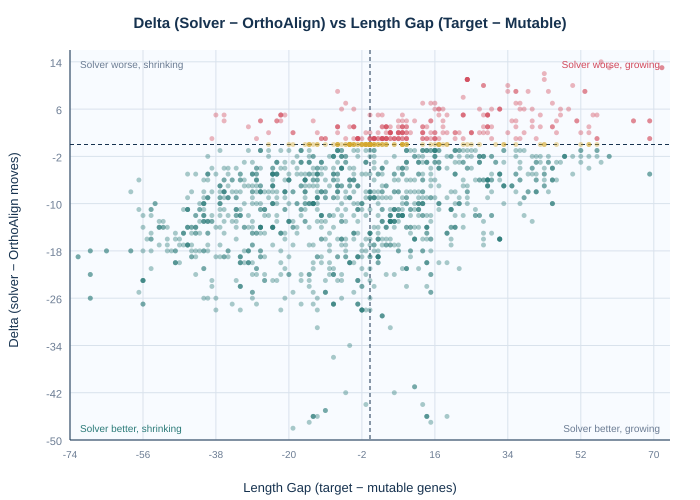
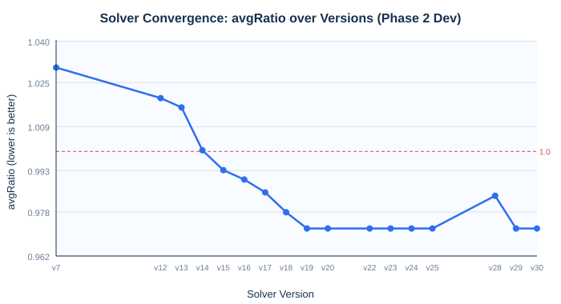

# AI-Assisted Heuristic Discovery for the Genome Sorting Problem: An Autoresearch Approach Applied to Clostridium tRNA Gene Orders

**Rogerio de Leon Pereira(1) and Olivier Tremblay-Savard(2)**

(1) School of Applied Computing, Sheridan College, Oakville, Ontario, Canada
(2) Department of Computer Science, University of Manitoba, Winnipeg, Manitoba, Canada

---

## Abstract

The genome sorting problem seeks the shortest sequence of evolutionary operations that transforms one genome into another. This problem is central to comparative genomics, where the edit distance between gene orders provides evidence for evolutionary relationships. We present a novel approach for discovering heuristic algorithms for this problem using an AI-driven iterative research loop adapted from the Karpathy autoresearch methodology. Our approach produces a terminus-anchored frontier-growing heuristic, discovered and refined through controlled experimentation on synthetic and real bacterial genome puzzles. We evaluate the resulting solver on a comprehensive all-pairs sweep of 51 Clostridium tRNA and rRNA gene orders (1,572 comparable directed pairs), demonstrating that it achieves solutions at or below the OrthoAlign reference cost on 84.2% of pairs, with an average cost ratio of 0.84 (i.e., 16% fewer operations on average). We further reveal a strong directional asymmetry in the heuristic search: growth-direction transformations are materially harder than contraction-direction ones, with a Pearson correlation of $r = 0.90$ between the genome length gap and the solver's directional move difference. This work contributes both a competitive solver for the restricted genome sorting problem and a reusable methodology for autonomous heuristic discovery in computational biology.

**Keywords:** genome sorting, genome rearrangement, heuristic search, autoresearch, tRNA gene order, Clostridium, computational biology

---

## 1. Introduction

### 1.1 The Genome Sorting Problem

Understanding how genomes evolve through large-scale structural changes is a fundamental question in comparative genomics. Genome rearrangement problems model the evolutionary distance between species by finding a minimum-cost sequence of operations — such as inversions, duplications, and deletions — that transforms one gene order into another (Fertin et al., 2009; Sankoff and Blanchette, 1998). These problems are computationally hard in general: even the simpler case of sorting by reversals alone is NP-hard for unsigned permutations (Caprara, 1997), and the addition of duplications, deletions, and constraints increases the complexity further.

The specific variant studied here is the Genome Sorting Problem (GSP), formulated as an interactive puzzle within the GeSort framework (de Leon Pereira et al., 2021). In this formulation, a player (or algorithm) must transform a *mutable genome* into a *target genome* using three operations — *inversion*, *duplication*, and *deletion* — subject to a key structural constraint: every inversion must include the *terminus* marker `[t]`, a distinguished central pivot in the genome. This constraint reflects biological reality in circular bacterial genomes, where the terminus of replication serves as a structural anchor for large-scale rearrangements (Hidaka et al., 1989).

### 1.2 Background and Prior Work

The GeSort citizen science game was developed to engage human players in solving genome rearrangement puzzles, with the goal of learning effective strategies from player behavior (de Leon Pereira et al., 2021). Analysis of expert player solutions revealed several recurring patterns: good solutions tend to start near the terminus and expand outward, large macro-moves outperform short local fixes, and inversions can replace multiple duplication–deletion sequences (de Leon Pereira and Tremblay-Savard, 2023). These insights were initially qualitative, and no automated solver existed to systematically exploit them.

OrthoAlign (Tremblay-Savard et al., 2015) represents a complementary approach. It aligns gene orders under a broader event model that includes substitutions, inversions, transpositions, and several duplication/loss variants. It has been applied to study tRNA and rRNA gene evolution in both Bacillus (Tremblay-Savard et al., 2015) and Clostridium (Chua et al., 2021) species. While OrthoAlign solves a related but not identical optimization problem, it provides a strong comparative baseline for evaluating gene order transformation costs.

The Clostridium genome dataset used in this study was prepared by Chua et al. (2021), who extracted and curated tRNA and rRNA gene orders from 51 Clostridium genomes used in the BOPAL 2.0 study. Figure 1 shows the phylogeny of these genomes.

*Figure 1.* The phylogeny of the Clostridium genomes considered (represented by their NCBI accession number). Pairs of genomes sharing a parent are considered close on the evolutionary scale and have a recent common ancestor (de Leon Pereira and Tremblay-Savard, 2023).

### 1.3 The Autoresearch Methodology

Our approach is inspired by the autoresearch methodology introduced by Karpathy (2026), where an AI agent iterates on a single editable artifact within a fixed experimental environment, keeping improvements and discarding regressions through automated evaluation. In the original setting, the artifact is a training script for a language model. In our adaptation, the editable artifact is `solver.js`, a heuristic genome sorting algorithm, and the fixed environment consists of the game engine, puzzle benchmarks, and scoring harnesses. The research loop proceeds as follows: (1) the agent proposes one hypothesis about what heuristic change might improve performance; (2) it implements the change; (3) it evaluates on a fixed development benchmark; (4) it keeps the change only if the score improves without regression on a continuity benchmark; and (5) it repeats.

This disciplines the search by enforcing a one-change-at-a-time policy, stable fitness metrics, and clean experimental controls. Both OpenAI GPT-5.4 and Anthropic Claude Opus 4.6 were used as AI agents within this loop.

### 1.4 Contributions

This paper makes the following contributions:

1. **A competitive heuristic solver** for the terminus-anchored genome sorting problem, discovered through iterative AI-assisted experimentation rather than manual design.
2. **A comprehensive evaluation** on 1,572 comparable directed pairs from 51 Clostridium tRNA/rRNA gene orders, showing that the solver matches or beats OrthoAlign on 84.2% of pairs.
3. **A characterization of directional asymmetry** in heuristic genome sorting, revealing that growth-direction transformations ($r = 0.90$) are systematically harder for the terminus-anchored strategy.
4. **A reusable methodology** that adapts autoresearch to combinatorial biology problems.

---

## 2. Problem Definition

### 2.1 Genome Representation

A genome is represented as an ordered list of gene symbols with a distinguished terminus marker `[t]`. Each gene represents a tRNA or rRNA family, and the terminus divides the genome into a left arm and a right arm, reflecting the bidirectional replication structure of circular bacterial chromosomes. In the notation used here, the origin marker `[o]` is stripped during parsing and does not participate in operations.

### 2.2 Allowed Operations

The solver may perform exactly three operations, each implemented in the game engine:

1. **Inversion.** A contiguous segment of genes is reversed in place. The segment *must* include `[t]`. This constraint ensures that inversions respect the terminus-anchored structure. An inversion crossing the terminus swaps material between the two replication arms.

2. **Duplication.** A contiguous segment of genes is copied and inserted at another position. If the source and destination are on opposite sides of `[t]`, the copied sequence is automatically reversed by the engine, modeling the strand-orientation effect of cross-terminus duplication events.

3. **Deletion.** A contiguous segment of genes is removed. The terminus cannot be deleted.

### 2.3 Objective

Given a mutable genome $M$ and a target genome $T$, find a sequence of valid operations that transforms $M$ into $T$ using the fewest total operations. All experiments in this study use a fixed budget of 150 operations.

### 2.4 Relationship to Edit-Distance Formulations

This problem differs from classical genome rearrangement formulations (Fertin et al., 2009) in several ways. The terminus constraint on inversions reduces the space of valid rearrangements. Duplications and deletions allow gene copy-number changes, which classical reversal-distance models do not support. The combination of these three operations under the terminus constraint defines a unique optimization landscape.

---

## 3. Methodology

### 3.1 Experimental Design

The research uses a three-phase design, inspired by machine learning best practices for avoiding overfitting:

**Phase 1** used a legacy benchmark of 8 puzzles spanning small synthetic cases (15–22 genes), medium synthetic cases (26 genes), large synthetic cases (115 genes), and real bacterial genome pairs (100 genes) from previous work (de Leon Pereira et al., 2021; de Leon Pereira and Tremblay-Savard, 2023). The AI agent iterated on the solver until performance plateaued on this benchmark.

**Phase 2** broadened the evaluation to a three-track design:
- A *legacy continuity track* (the original 8 puzzles, frozen for backward comparison).
- A *Phase 2 development track* (14 puzzles mixing synthetic and genomic cases, including new Clostridium pairs from the dataset of Chua et al. (2021)).
- A *Phase 2 holdout track* (4 puzzles reserved for milestone validation only).

The genomic puzzles were generated by extracting pairs of Clostridium gene orders where all gene symbols in the target appear in the mutable genome. Reference scores for these puzzles come from OrthoAlign. As noted in Section 2.4, OrthoAlign uses a broader event model, so its scores are informative comparative references rather than strict lower bounds for our engine.

**Phase 3** focused on computational efficiency. The Phase 2 winner (solver version `v19`) was frozen, and a curated set of 8 hard genomic puzzles — mined from the loss clusters in the full Clostridium sweep — was used as the development target. Changes that improved runtime without degrading quality were kept.

### 3.2 The Autoresearch Loop

Each iteration of the research loop follows this protocol:

1. The AI agent reads the current solver code, the most recent evaluation results, and the research guidelines.
2. It proposes one hypothesis about what change should help (e.g., "cap frontier duplication sources in strong growth states").
3. It implements the change in `solver.js` only.
4. It runs the development benchmark and checks for improvement.
5. If improved, it verifies no regression on the continuity benchmark.
6. If both checks pass, the change is kept and logged. Otherwise, it is reverted.

This process was repeated until the solver's performance on both Phase 2 tracks reached a stable plateau. The solver progressed from version `v0` (0/8 puzzles solved) through `v19` (Phase 2 winner) to `v30` (final frozen version). Table 1 shows the milestone progression.

**Table 1.** Solver milestone progression.

| Version | Phase | Key Addition | Phase 2 Dev avgRatio |
|:-------:|:-----:|:-------------|:--------------------:|
| v0 | 1 | Baseline (stuck on all puzzles) | — |
| v7 | 2 | Phase 2 baseline | 1.031 |
| v14 | 2 | Multiple frontier block lengths | 1.000 |
| v16 | 2 | Short improving inversion shortlist | 0.993 |
| v17 | 2 | Duplication-length rollout | 0.988 |
| v19 | 2 | Opening inversion rollout + neutral inversions | 0.972 |
| v30 | 3 | Growth-aware pruning, delayed deletions | 0.972 |

### 3.3 Fitness Metric

The primary fitness metric is:

$$\text{avgRatio} = \frac{1}{n} \sum_{i=1}^{n} \frac{\text{solver moves}_i}{\text{reference score}_i}$$

A ratio below 1.0 means the solver uses fewer moves than the reference on average. Secondary metrics include the number of solved puzzles, the number of optimal solutions, and per-category breakdowns (synthetic vs. real).

### 3.4 Genomic Puzzle Generation

Genomic puzzles are derived from real Clostridium tRNA and rRNA gene orders prepared by Chua et al. (2021). Each directed pair consists of a mutable genome $M$ and a target genome $T$, both drawn from the same 51-genome family. A pair is considered *solvable* if every unique gene symbol in $T$ also appears in $M$ (so the solver can, in principle, construct $T$ from $M$ through duplications, deletions, and inversions). Of the 2,550 total directed pairs, 1,729 meet this solvability criterion.

---

## 4. The Heuristic Algorithm

### 4.1 Overview

The final solver (`v30`) is a greedy search with one-step lookahead and bounded rollout. Its core strategy is *terminus-anchored frontier growth*: it maintains an exact matching core around `[t]` and expands it outward using macro-moves at the frontier.

### 4.2 Anchored Core Computation

At each step, the solver computes the *anchored core*: the longest contiguous run of genes, centered on `[t]`, that already matches the target genome exactly in both content and order. This core defines two *frontiers* — the left boundary and the right boundary — where the next useful operation is most likely to occur.

### 4.3 Candidate Generation

The solver generates candidates from five families:

1. **Frontier duplications.** If the target's next genes beyond the current frontier exist elsewhere in the mutable genome, the solver proposes copying them to extend the anchored core. Multiple source locations and block lengths are considered (up to 64 genes, with 8 source matches and 3 length options per side).

2. **Frontier deletions.** If genes at the frontier boundary do not belong to the target's expected continuation, the solver proposes removing them. Deletions are delayed during strong growth states (when the target is more than 20 genes longer than the current genome) until the length gap narrows to within 3 genes.

3. **Inversions.** Inversions around `[t]` can reorient misaligned segments. The solver considers inversions up to radius 12 from the terminus. After the opening phase (once the anchored core exceeds a threshold), inversion generation is reduced in strong growth states.

4. **Short improving inversions.** A small pool of short inversions that immediately improve the score is added to the shortlist, even if they rank below other candidates.

5. **Neutral inversions.** Near-neutral inversions are included as potential setup moves that enable cheaper subsequent operations.

### 4.4 Move Evaluation and Selection

Each candidate move is scored using a multi-component tuple that considers:
- The length of the anchored core after the move.
- Gene count repair (how close the mutable genome's gene counts are to the target's).
- Genome length repair (how close the overall length is to the target's).

The top 8 candidates by immediate score enter a one-step lookahead: the solver simulates each move, then evaluates the best follow-up move and selects the candidate with the best two-move outlook.

### 4.5 Bounded Rollout Mechanisms

Two bounded rollouts extend foresight beyond one step:

1. **Opening inversion rollout.** When the anchored core is still small ($\leq 1$ matched gene on each side), the solver compares the greedy choice against up to 8 inversion candidates rolled out for up to 24 moves. This allows structural resets at the start of a puzzle to compete with immediate greedy expansions.

2. **Duplication-length rollout.** When a frontier duplication is selected, the solver compares up to 4 alternative block lengths rolled out for up to 12 moves each, choosing the length that leads to the fewest total moves. This is skipped during strong growth states.

### 4.6 Growth-Aware Pruning (v19 → v30)

The key difference between `v19` and `v30` is a set of pruning rules for *strong growth states*, defined as states where the target is more than 20 genes longer than the mutable genome:
- Frontier deletions are delayed until the length gap narrows to $\leq 3$ genes.
- Duplication-length rollout is skipped entirely.
- Frontier duplication sources are capped at 4 nearest occurrences (instead of 8).
- Inversions are suppressed after the opening phase.

These changes reduce the search space during the expansion phase of long-growth puzzles. As shown in Section 5, they improved runtime by 8.8% without changing solution quality on the full Clostridium sweep.

---

## 5. Results

### 5.1 Full Clostridium Sweep

We evaluated the frozen `v30` solver on all 1,729 solvable directed pairs from the 51-genome Clostridium family. Of these, 1,572 pairs had valid scores from both the solver and OrthoAlign, forming the set of *comparable pairs*.

**Table 2.** Summary of the all-pairs Clostridium sweep with solver `v30`.

| Metric | Value |
|:-------|------:|
| Genomes | 51 |
| Solvable directed pairs | 1,729 |
| Comparable pairs | 1,572 |
| Solver better than OrthoAlign | 1,210 (77.0%) |
| Solver equal to OrthoAlign | 113 (7.2%) |
| Solver worse than OrthoAlign | 249 (15.8%) |
| At or below OrthoAlign | 1,323 (84.2%) |
| Average OrthoAlign cost | 43.88 moves |
| Average solver cost | 35.57 moves |
| Average delta (solver $-$ OrthoAlign) | $-8.31$ moves |
| Median delta | $-7.50$ moves |
| Average ratio (solver / OrthoAlign) | 0.840 |
| Median ratio | 0.821 |
| Average OrthoAlign runtime | 340 ms |
| Average solver runtime | 14,738 ms |

Figure 2 provides a visual overview of the quality–runtime tradeoff. The left panel shows that most pairs fall on the solver-favorable side of the delta distribution, confirming that the quality advantage is broad rather than driven by a few outliers. The right panel shows the runtime cost: the solver is approximately 43× slower than OrthoAlign on average.

Figure 3 shows the full distribution of the solver/OrthoAlign ratio across all 1,572 comparable pairs. The distribution is strongly left-skewed, with the bulk of pairs below 1.0 (median 0.821, mean 0.840), confirming that the solver advantage is widespread.

*Figure 2.* Quality-runtime overview. Left: distribution of $\Delta = \text{solver cost} - \text{OrthoAlign cost}$ across 1,572 comparable pairs; negative values indicate solver wins. Right: runtime comparison showing the solver's computational cost.

*Figure 3.* Distribution of the solver/OrthoAlign cost ratio across 1,572 comparable pairs. Values below 1.0 (green) indicate solver wins; values above 1.0 (red) indicate OrthoAlign wins. The distribution is strongly left-skewed.

### 5.2 Comparison with v19

The `v30` sweep is quality-flat relative to the archived `v19` sweep:

**Table 3.** Comparison between `v19` (Phase 2 winner) and `v30` (final solver).

| Metric | v19 | v30 |
|:-------|----:|----:|
| Average ratio | 0.840 | 0.840 |
| Solver better | 1,207 | 1,210 |
| Solver equal | 123 | 113 |
| Solver worse | 242 | 249 |
| Average solver runtime (ms) | 16,153 | 14,738 |
| Runtime improvement | — | 8.8% |

The main benefit of Phase 3 was computational efficiency. The growth-aware pruning reduced average per-pair runtime by 1,415 ms (8.8%) without a meaningful quality shift on the full sweep.

### 5.3 Phase 2 Holdout Results

On the 4-puzzle Phase 2 holdout set, the final `v30` solver achieved:

**Table 4.** Phase 2 holdout results for `v30`.

| Metric | Value |
|:-------|------:|
| Solved | 4/4 |
| Optimal | 3/4 |
| Average ratio | 0.889 |
| Synthetic avgRatio | 0.951 |
| Real avgRatio | 0.826 |

### 5.4 Loss Pattern Analysis

The solver's losses are sharply concentrated rather than diffuse across the comparison space. Figure 4 shows the loss cluster heatmap.

*Figure 4.* Loss cluster heatmap. Red cells indicate pairs where the solver used more moves than OrthoAlign. Losses concentrate in specific mutable–target combinations rather than spreading uniformly.

The primary loss cluster involves `AP012212_1042156.4` as the mutable genome, with 20 worse-than-OrthoAlign pairs and an average delta of $+4.13$. Its hardest targets are the long repeated genomes `CP000721_290402.41` and `CP006777_864803.3` (both 138 genes). A secondary cluster involves compact 23-gene-family mutables (`CP001078`, `CP010520`, `CP010521`) losing specifically against these same long targets.

This pattern is the signature of a *growth-phase weakness*: the solver struggles most when a short mutable genome must be expanded into a much longer target.

### 5.5 Directional Asymmetry

A striking property of the heuristic is its directional asymmetry. Of 524 canonical pairs available for bidirectional comparison, OrthoAlign produces symmetric or near-symmetric costs (mean absolute difference: 1.25 moves; 35% perfectly symmetric). In contrast, the solver shows strong differences between directions (mean absolute difference: 7.34 moves; only 7% perfectly symmetric).

The asymmetry correlates strongly with the genome length gap:

$$r(\text{target length} - \text{mutable length},\ \text{solver moves}_{A \to B} - \text{solver moves}_{B \to A}) = 0.90$$

**Table 5.** Directional asymmetry by transformation direction.

| Direction | $n$ | Mean solver diff (fwd $-$ rev) | Growth harder (%) |
|:----------|----:|-------------------------------:|------------------:|
| Expanding (mutable shorter) | 315 | $+7.26$ | 85.7 |
| Shrinking (mutable longer) | 195 | $-6.79$ | 90.3 (contraction easier) |
| Same length | 14 | $-0.50$ | n/a |

The magnitude scales with the size of the length gap:

**Table 6.** Directional asymmetry magnitude by length gap.

| Length gap | $n$ | Mean $\lvert\text{solver diff}\rvert$ |
|:-----------|----:|--------------------------------------:|
| 0–20 genes | 289 | 4.10 |
| 21–50 genes | 198 | 9.73 |
| 51+ genes | 37 | 19.86 |

Figure 5 visualizes this relationship directly.

*Figure 5.* Directional asymmetry versus length gap. Each point represents a canonical pair. The $x$-axis shows the length difference (target $-$ mutable), and the $y$-axis shows the solver's directional move difference. The strong positive trend ($r = 0.90$) reveals that growth is systematically harder than contraction.

Figure 6 shows the delta versus length gap for all 1,572 comparable pairs (not only the bidirectional subset), confirming that the growth-difficulty relationship is visible across the full sweep: pairs with large positive length gaps tend to cluster in the solver-worse region.

*Figure 6.* Delta (solver $-$ OrthoAlign) versus length gap (target $-$ mutable) for all 1,572 comparable pairs. Pairs where the target is much longer than the mutable (right side) tend to produce positive deltas (solver-worse), confirming the growth-phase weakness.

### 5.6 Best and Worst Pairs

The strongest solver wins involve genome `CP006908_1408283.5`, where deltas reach $-46$ to $-48$ moves (Table 7). These are cases where the frontier-growing heuristic resolves the puzzle with a small number of large structural edits near `[t]`.

**Table 7.** Top 5 best and worst pairs by delta.

| Mutable | Target | OrthoAlign | Solver | $\Delta$ |
|:--------|:-------|:----------:|:------:|:--------:|
| AP014696 | CP006908 | 55 | 7 | $-48$ |
| CP000939 | CP006908 | 53 | 6 | $-47$ |
| CP006908 | CP000939 | 56 | 9 | $-47$ |
| CP000728 | CP006908 | 52 | 6 | $-46$ |
| CP000962 | CP006908 | 52 | 6 | $-46$ |
| AP012212 | CP010994 | 52 | 66 | $+14$ |
| AP012212 | CP010993 | 53 | 66 | $+13$ |
| AP012212 | CP000721 | 60 | 73 | $+13$ |
| AP012212 | CP006777 | 60 | 73 | $+13$ |
| AP012212 | CP002160 | 48 | 60 | $+12$ |

---

## 6. Discussion

### 6.1 Quality of the Heuristic

The main finding is that the terminus-anchored frontier-growing heuristic, discovered through iterative AI-assisted experimentation, is highly competitive with OrthoAlign on the Clostridium tRNA/rRNA gene family. On 84.2% of comparable pairs, the solver produces solutions that are equal to or shorter than OrthoAlign's alignment cost. This is notable because the solver uses a more restricted operation set (no substitutions, no transpositions), while OrthoAlign uses a broader event model.

The quality advantage is broad: the median delta of $-7.5$ and the spread of wins across many genome pairs (Figures 2 and 3) show that the solver's effectiveness does not depend on a few outlier cases.

### 6.2 The Autoresearch Approach

The iterative research loop produced a clear progression from a solver that could not solve any puzzle (v0) to one that achieves sub-OrthoAlign costs on most real genomic pairs (v19/v30). The one-change-at-a-time protocol made each improvement interpretable and attributable to a specific heuristic idea.

Several heuristic discoveries emerged from the loop that were not obvious from prior human-player observations:

- **Opening inversion rollout**: structural inversions at the very beginning of a puzzle, even when they temporarily worsen the score, can lead to substantially shorter overall solutions.
- **Duplication-length ambiguity**: the longest available frontier block is not always the best choice; shorter blocks can yield shorter total solutions.
- **Growth-aware search reduction**: during long expansion phases, most candidate families (deletions, multiple block lengths, inversions after the opening) rarely win, so pruning them improves runtime without quality loss.

Figure 7 shows the convergence of the avgRatio metric across solver versions on the Phase 2 development track. The curve shows a clear improvement trajectory from v7 (ratio 1.03) to v19 (ratio 0.97), followed by a stable plateau through v30. The small bump at v28 reflects a Phase 3 runtime-focused change that temporarily regressed one Phase 2 dev puzzle; this was corrected two versions later when the deletion-delay threshold was refined.

*Figure 7.* Solver convergence on the Phase 2 development track. Each point represents the best avgRatio achieved by a solver version. The autoresearch loop drove consistent improvement before reaching a plateau at v19.

These findings support the view that autoresearch can serve as a *heuristic discovery pipeline* for computational biology problems, not just as a code optimization tool.

### 6.3 Directional Asymmetry

The directional asymmetry (Section 5.5) is a heuristic bias, not a property of the underlying edit distance. OrthoAlign's near-symmetry ($\text{mean } |\Delta| = 1.25$) confirms that the true transformation cost is approximately direction-independent. The solver's asymmetry arises because its terminus-anchored strategy prefers to grow an exact core from existing material, which works well in contraction (where the material already exists and only needs trimming) but struggles in long growth (where substantial new material must be duplicated in a specific order).

This finding identifies the clearest open algorithmic weakness and suggests that bidirectional search — trying both $A \to B$ and $B \to A$ and taking the shorter path — could improve performance on growth-dominated pairs. However, our preliminary experiments with reverse-direction bootstrapping (`v31`–`v32`) did not yield improvements, suggesting that a more sophisticated integration of growth-direction and contraction-direction strategies is needed.

### 6.4 Comparison with OrthoAlign

OrthoAlign (Tremblay-Savard et al., 2015) solves a different optimization problem. It models a broader set of evolutionary events including substitutions, transpositions, inversions, and duplication/loss variants. Our engine restricts to inversions (terminus-anchored), duplications, and deletions. Therefore:

- Beating OrthoAlign on a given pair shows that our restricted move set is effective for that pair, but does not prove our engine has a tighter lower bound.
- Losing to OrthoAlign does not necessarily indicate a heuristic failure; OrthoAlign may achieve a lower cost by using events (e.g., transpositions) that our engine does not support.
- The comparison is informative but not a fully like-for-like benchmark.

Despite these caveats, the fact that our solver matches or beats OrthoAlign on 84.2% of pairs provides strong evidence that the restricted GeSort move set is competitive for this biological family.

### 6.5 Runtime Considerations

The solver is substantially slower than OrthoAlign: approximately 14.7 seconds per pair versus 0.34 seconds. This is a significant limitation for large-scale genomic studies. Phase 3 pruning improved runtime by 8.8% without quality loss, but a more fundamental speedup would require algorithmic changes to the search structure (e.g., memoization, parallelism, or a shift from greedy-plus-rollout to more efficient search methods such as beam search or A* with problem-specific bounds).

### 6.6 Limitations

1. **OrthoAlign is not a strict lower bound.** Because OrthoAlign uses a broader event model, its scores do not represent optimal solutions under our engine's rules.
2. **Three genomes excluded.** Three of the 51 genomes do not contain exactly one `[t]` and are excluded from the solver comparison (153 pairs).
3. **Fixed 150-move budget.** The budget is generous for most pairs but could affect the solver on very hard instances.
4. **Single gene family.** The evaluation uses only Clostridium tRNA/rRNA gene orders. Generalization to other gene families or species requires further study.
5. **Heuristic, not exact.** The solver is a heuristic with no optimality guarantee. The true optimal cost under our engine's rules is unknown for most pairs.

---

## 7. Related Work

### 7.1 Genome Rearrangement Algorithms

The genome rearrangement problem has a rich algorithmic history. Hannenhalli and Pevzner (1999) developed a polynomial-time algorithm for sorting signed permutations by reversals. For unsigned permutations, sorting by reversals is NP-hard (Caprara, 1997). When gene duplications and losses are considered, the problem becomes substantially harder (El-Mabrouk, 2000; Shao and Moret, 2015). Recent work has explored the use of Integer Linear Programming (Shao and Moret, 2015) and approximation algorithms for variants with duplications (Jiang et al., 2012; Bader, 2009).

### 7.2 Citizen Science and Gamification

The GeSort game (de Leon Pereira et al., 2021) follows a line of research on citizen science games for computational biology, including Phylo (Kawrykow et al., 2012), Foldit (Cooper et al., 2010), and EteRNA (Lee et al., 2014). These games demonstrate that human intuition can provide useful heuristic insights for hard computational problems. Our work extends this by using insights from human players to seed an automated heuristic search.

### 7.3 AI-Assisted Algorithm Design

The autoresearch methodology (Karpathy, 2026) connects to the broader area of AI-assisted algorithm design, including neural combinatorial optimization (Vinyals et al., 2015; Bello et al., 2016) and the use of large language models for code generation and optimization (Chen et al., 2021; Li et al., 2022). Our approach differs in using the LLM as a *research agent* that proposes, tests, and interprets structured experiments rather than directly outputting solutions. This iterative loop preserves interpretability and produces an explainable heuristic rather than a black-box model.

FunSearch (Romera-Paredes et al., 2024) represents a related approach where large language models evolve programs for mathematical optimization problems. While FunSearch uses an evolutionary strategy over program populations, our approach uses a sequential hypothesis-testing loop with explicit version control and regression testing.

---

## 8. Conclusion

We presented an AI-assisted heuristic discovery approach for the genome sorting problem, adapted from the Karpathy autoresearch methodology. The resulting solver uses a terminus-anchored frontier-growing strategy with bounded rollout mechanisms, discovered and refined through controlled experimentation across three research phases. This core strategy — growing outward from the terminus toward the genome edges — was inspired by how human players naturally solve puzzles in the GeSort game, and the autoresearch loop refined it into a precise algorithmic form.

On a comprehensive all-pairs evaluation of 51 Clostridium tRNA/rRNA gene orders (1,572 comparable pairs), the solver produced solutions at or below the OrthoAlign reference cost on 84.2% of pairs, with an average ratio of 0.84. The analysis revealed a strong directional asymmetry ($r = 0.90$): growth-direction transformations are systematically harder for the heuristic than contraction-direction ones. Phase 3 optimization improved runtime by 8.8% without quality loss.

These findings demonstrate that the autoresearch approach can produce competitive heuristic algorithms for computational biology problems. The directional asymmetry and growth-phase weakness identified here provide clear targets for future algorithmic improvement.

### Future Work

- Developing bidirectional search strategies to mitigate growth-direction asymmetry.
- Investigating more efficient search architectures (beam search, A*) to reduce runtime.
- Extending the evaluation to other bacterial families beyond Clostridium.
- Exploring hybrid approaches that combine the heuristic solver with OrthoAlign's broader event model.
- Applying the autoresearch methodology to other combinatorial biology problems.

---

## Data Availability

The complete evaluation data, including all 1,729 evaluated pairs, the solver source code, and the figure generation scripts, are available in the project repository.

---

## Acknowledgments

The Clostridium genome dataset was prepared by Chua et al. (2021) as part of the BOPAL 2.0 study pipeline. OpenAI GPT-5.4 and Anthropic Claude Opus 4.6 were used as AI agents to run the autoresearch loop and produce the artifacts in this study.

---

## References

Bader M. Sorting by reversals, block interchanges, tandem duplications, and deletions. BMC Bioinformatics. 2009 Jan 30;10 Suppl 1(Suppl 1):S9. doi: 10.1186/1471-2105-10-S1-S9. PMID: 19208182; PMCID: PMC2648760. https://doi.org/10.1186/1471-2105-10-s1-s9

Bello, I., Pham, H., Le, Q. V., Norouzi, M., and Bengio, S. (2016). Neural combinatorial optimization with reinforcement learning. *arXiv preprint arXiv:1611.09940*. 

Caprara, A. (1997). Sorting by reversals is difficult. In *Proceedings of the First Annual International Conference on Computational Molecular Biology (RECOMB '97)*, pp. 75–83. ACM. https://doi.org/10.1145/267521.267531

Chen, M., Tworek, J., Jun, H., Yuan, Q., Pinto, H. P. O., Kaplan, J., Edwards, H., Burda, Y., Joseph, N., Brockman, G., et al. (2021). Evaluating large language models trained on code. *arXiv preprint arXiv:2107.03374*.

Chua, M., Tan, A., and Tremblay-Savard, O. (2021). BOPAL 2.0 and a study of tRNA and rRNA gene evolution in Clostridium. *Journal of Bioinformatics and Computational Biology*, 19(6), 2140007. https://doi.org/10.1142/S0219720021400072

Cooper, S., Khatib, F., Treuille, A., Barbero, J., Lee, J., Beenen, M., Leaver-Fay, A., Baker, D., Popovic, Z., and Players, F. (2010). Predicting protein structures with a multiplayer online game. *Nature*, 466(7307), 756–760. https://doi.org/10.1038/nature09304

de Leon Pereira, R., Tan, A., Bunt, A., and Tremblay-Savard, O. (2021). Increasing player engagement, retention and performance through the inclusion of educational content in a citizen science game. In *Proceedings of the 16th International Conference on the Foundations of Digital Games (FDG '21)*, Article 16, pp. 1–12. ACM. https://doi.org/10.1145/3472538.3472554

de Leon Pereira, R. and Tremblay-Savard, O. (2023). Lessons learned from video game players sorting genomes. In *Proceedings of the 18th International Conference on the Foundations of Digital Games (FDG '23)*, Article 37, pp. 1–11. ACM. https://doi.org/10.1145/3582437.3582472

El-Mabrouk, N. (2000). Genome rearrangement by reversals and insertions/deletions of contiguous segments. In *Proceedings of the 11th Annual Symposium on Combinatorial Pattern Matching (CPM 2000)*, LNCS 1848, pp. 222–234. Springer. https://doi.org/10.1007/3-540-45123-4_20

Fertin, G., Labarre, A., Rusu, I., Tannier, E., and Vialette, S. (2009). *Combinatorics of Genome Rearrangements*. MIT Press.

Hannenhalli, S. and Pevzner, P. A. (1999). Transforming cabbage into turnip: polynomial algorithm for sorting signed permutations by reversals. *Journal of the ACM*, 46(1), 1–27. https://doi.org/10.1145/300515.300516

Jiang, H., Zheng, C., Sankoff, D., and Zhu, B. (2012). Scaffold filling under the breakpoint and related distances. IEEE/ACM Transactions on Computational Biology and Bioinformatics, 9(4), 1220–1229. https://doi.org/10.1109/TCBB.2012.57

Karpathy, A. (2026). autoresearch. GitHub repository. https://github.com/karpathy/autoresearch

Kawrykow, A., Roumanis, G., Kam, A., Kwak, D., Leung, C., Wu, C., Zarour, E., Sarmenta, L., Blanchette, M., and Waldispuhl, J. (2012). Phylo: a citizen science approach for improving multiple sequence alignment. *PLoS ONE*, 7(3), e31362. https://doi.org/10.1371/journal.pone.0031362

Lee, J., Kladwang, W., Lee, M., Cantu, D., Azizyan, M., Kim, H., Limpaecher, A., Gee, S., Pustilnik, A., Das, R., et al. (2014). RNA design rules from a massive open laboratory. *Proceedings of the National Academy of Sciences*, 111(6), 2122–2127. https://doi.org/10.1073/pnas.1313039111

Li, Y., Choi, D., Chung, J., Kushman, N., Schrittwieser, J., Leblond, R., Eccles, T., Keeling, J., Gimeno, F., Dal Lago, A., et al. (2022). Competition-level code generation with AlphaCode. *Science*, 378(6624), 1092–1097. https://doi.org/10.1126/science.abq1158

Hidaka, M. Kobayashi, T. Horiuchi, S. Takenaka, H. Takeya, and T. Horiuchi. (1989). Purification of a dna replication terminus (ter) site-binding protein in escherichia coli and identification of the structural gene. *Journal of Biological Chemistry*, 264(35):21031–21037. PMID: 2687269.

Romera-Paredes, B., Barekatain, M., Novikov, A., Balog, M., Kumar, M. P., Dupont, E., Ruiz, F. J. R., Ellenberg, J. S., Wang, P., Fawzi, O., et al. (2024). Mathematical discoveries from program search with large language models. *Nature*, 625(7995), 468–475. https://doi.org/10.1038/s41586-023-06924-6

Sankoff, D. and Blanchette, M. (1998). Multiple genome rearrangement and breakpoint phylogeny. *Journal of Computational Biology*, 5(3), 555–570. https://doi.org/10.1089/cmb.1998.5.555

Shao, M. and Moret, B. M. E. (2015). Comparing genomes with rearrangements and segmental duplications. *Bioinformatics*, 31(12), i329–i338. https://doi.org/10.1093/bioinformatics/btv229

Tremblay-Savard, O., Benzaid, B., Lang, B. F., and El-Mabrouk, N. (2015). Evolution of tRNA repertoires in Bacillus inferred with OrthoAlign. *Molecular Biology and Evolution*, 32(6), 1643–1656. https://doi.org/10.1093/molbev/msv029

Vinyals, O., Fortunato, M., and Jaitly, N. (2015). Pointer networks. In *Advances in Neural Information Processing Systems 28 (NeurIPS 2015)*, pp. 2692–2700. https://papers.nips.cc/paper_files/paper/2015/file/29921001f2f04bd3baee84a12e98098f-Paper.pdf